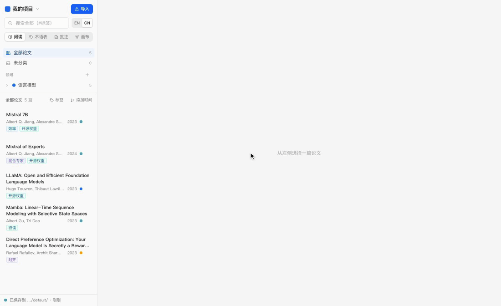

# Paperloom 织读

[English](README.en.md)

**把读过的每篇论文，织成你自己的知识网。**

本地优先的论文阅读器：在浏览器里读 PDF、划线写笔记，并且建立自己的术语表——**给一个术语或缩写写一次笔记，它在所有论文里出现的每一处都会被标出，点一下就能看到你的笔记。**

论文和笔记只保存在你自己的电脑上，不上传到任何服务器。

**在线试用：<https://horizon-42.github.io/paperloom/>**（打开就能用，数据只存在你的浏览器里）



<sub>演示中的论文均以 CC BY 4.0 许可发布于 arXiv：Mistral 7B（[2310.06825](https://arxiv.org/abs/2310.06825)）、Mixtral of Experts（[2401.04088](https://arxiv.org/abs/2401.04088)）、LLaMA（[2302.13971](https://arxiv.org/abs/2302.13971)）、Mamba（[2312.00752](https://arxiv.org/abs/2312.00752)）、DPO（[2305.18290](https://arxiv.org/abs/2305.18290)）。</sub>

## 功能

- **精确到词的高亮批注**：基于 PDF 字形位置定位，高亮贴合每个字，不会偏到半个词。笔记用 Markdown（支持公式），显示在页边，与原文对齐。
- **个人术语表**：术语可以有多个别名（缩写、全称、复数），所有论文中匹配到的位置自动加下划线；可以限定只在某些领域生效，避免同一个缩写在不同领域含义冲突。
- **文库管理**：领域像文件夹一样可嵌套、展开收起，论文就在其中，拖动即可移动；一篇论文可以属于多个领域；也可以切到「全部」按时间、年份或标签浏览。
- **多篇对照**：标签页切换，左右分屏。
- **笔记画布**：把批注、术语、论文摆在画布上连线整理思路。
- **项目**：每个项目一套独立的论文和笔记，可以在不同浏览器标签页同时打开。
- **导入导出**：JSON 完整备份；术语和批注导出为 Markdown，可以放进 Obsidian。

界面支持英文和中文：默认英文，点侧栏搜索框右边的 **EN | CN** 切换，选择会被记住。

## 两种用法

### 在线版（打开就能用）

数据保存在浏览器里（IndexedDB）。清除浏览器的网站数据、换浏览器或换电脑后会看不到，请定期在左下角「数据与备份」中导出备份。JSON 备份包含论文信息、批注、术语和画布，**不含 PDF 文件本身**，原 PDF 请自己保留；在新的浏览器里导入备份后，再把这些 PDF 导入一次即可对上。

### 本地运行（推荐长期使用）

需要 [Node.js](https://nodejs.org/) 22.13 或更新版本。

```bash
git clone https://github.com/Horizon-42/paperloom.git
cd paperloom
npm install
npm run dev
```

然后打开 <http://localhost:5173>。本地运行时，所有数据会自动镜像到仓库目录下的 `data/` 文件夹（论文 PDF、`library.json`、Markdown 笔记），浏览器数据丢了也能从这里恢复。用 `PAPERLENS_DATA_DIR=<目录> npm run dev` 可以把数据放到别处（例如同步盘）。

本地服务只接受本机的请求。

## 自己部署在线版

```bash
npm run build:web   # 输出到 dist/，用相对路径，可以放在任意子路径下
```

把 `dist/` 放到任意静态网站托管即可。仓库里附带了 GitHub Pages 的工作流（`.github/workflows/pages.yml`）：在仓库的 Settings → Pages 中把 Source 设为 GitHub Actions，推送到 `main` 后会自动部署。

## 开发

```bash
npm run typecheck   # 类型检查
npm test            # 单元测试（Vitest）
npm run e2e         # 端到端测试（Playwright）
npx playwright test -c tests/e2e/static.config.ts   # 在线版冒烟测试
```

需求与设计见 `Paperloom 论文阅读器开发文档.md`，与它不同的设计决定记录在 `docs/decisions.md`。

技术栈：React、TypeScript、Vite、pdf.js、Dexie（IndexedDB）、Zustand、Tailwind CSS、Radix UI、CodeMirror、React Flow。

## 已知限制

- 扫描版 PDF 需要自带文字层（OCR 过的）才能选中文字和匹配术语。
- 不做多设备同步和多人协作。

## 许可证

[MIT](LICENSE)
